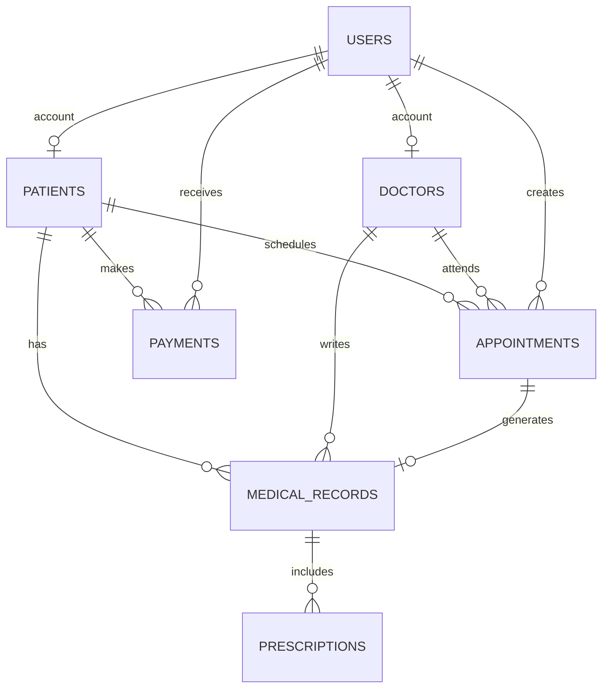

# Project Guide: St. Lucy Digital Patient Management System

## 1. Purpose and Source Review

The provided material describes St. Lucy Medical Clinic in Kikumi, Makerere, Uganda. It identifies paper-based patient records, outpatient scheduling, financial tracking, and health education as pain points. Its stated goals are faster record retrieval, shorter outpatient waits, more accountable transactions, and improved access to education.

The source set was reviewed as follows:

- `DIGITAL PATIENT MANAGEMENT SYSTEM.pdf`: business context, objectives, functional requirements, entities, attributes, logical-design notes, and a second ERD.
- `GROUP 7 DPMSERDDD.pdf`: the Group 7 ERD plus field definitions for users, doctors, patients, appointments, medical records, payments, and prescriptions.
- `Database deisgn .docx`: the required 14-step implementation sequence, including PostgreSQL, `psycopg2`, per-entity modules, Tkinter, authentication, reports, and end-to-end tests.
- `PHOTO-2026-10-09-10-17-54.jpg`: assignment rubric. It calls out an overall ERD, relationships/cardinality, PKs/FKs, Crow's Foot notation, weak/strong relationships, DBMS implementation, forms/reports, validation, and a 20–50-record sample dataset.

The longer report's non-functional-requirements heading repeats functional requirements rather than listing measurable quality requirements. This implementation therefore demonstrates practical data integrity, password hashing, role-oriented navigation, and input validation, while the guide explicitly marks security and deployment limits that still need work before any real clinic use.

## 2. Model Decisions and Relationships

The original model is preserved and reconciled where the supplied documents differ:

- `users` stores staff and patient login identities. The group ERD links a doctor to a user; `doctors.user_id` is therefore an optional unique foreign key. Patient accounts similarly use optional `patients.user_id` for self-registration.
- `doctors.role` follows the data dictionary. `specialty`, contact details, and an active flag are additional practical fields.
- `appointments` links one patient and one doctor to a dated/time slot. One patient can have many appointments; one doctor can attend many appointments. A trigger prevents two non-cancelled appointments for the same patient or doctor at the same time.
- `medical_records` links to a patient, doctor, and one appointment. A trigger verifies that the appointment's patient and doctor match the record. Each appointment can have at most one record in this model.
- `prescriptions` is its own table, linked to a medical record, as shown in the Group 7 ERD and dictionary.
- `payments` links each payment to the patient who paid. Receipt numbers are unique; amounts must be positive.
- `learning_resources` is an added catalogue of external health-education links. Patients and non-admin staff see active links; administrators can manage active and inactive resources.

Every primary key is generated by PostgreSQL. Foreign keys use restrictive deletion where an audit/history relationship should not silently disappear. The model keeps the original core patient, doctor, appointment, record, and payment entities while storing prescriptions and learning resources separately rather than repeating data.



The account links and created-by/received-by links are nullable where a record can exist without an authenticated actor. The diagram expresses logical cardinality, not a production-ready security boundary.

## 3. Navigate the Project in the Required Order

The following maps each step in the Word brief to what is implemented and how to proceed.

1. **Finalize the ERD.** Review Section 2 and the Mermaid diagram. Confirm the appointment-to-medical-record rule (one record per appointment), optional account links, and learning-resource extension with the group before changing the model.
2. **Create PostgreSQL database.** Install/start PostgreSQL, then run `createdb st_lucy_dpms`. The database server must be running before Python commands that connect to it.
3. **Create tables.** Configure `.env`, then run `python init_db.py`. The script executes `sql/schema.sql` against the database named by `DATABASE_URL` or the `PG*` variables.
4. **Add primary keys, foreign keys, and constraints.** These are in `sql/schema.sql`: generated primary keys, foreign keys, unique values, enumerated status/role/gender/payment method, positive payment amounts, date checks, and URL checks.
5. **Insert 20–50 sample records.** Run `python seed.py`. On a clean schema it inserts 40 fictional rows across users, doctors, patients, appointments, medical records, prescriptions, payments, and education resources. The records and contacts are deliberately fake. The seed script is designed to be repeatable.
6. **Test SQL queries.** Use the queries in Section 8 in `psql` or a PostgreSQL client. Confirm expected counts and relationships before launching the forms.
7. **Implement validation triggers.** The schema creates appointment-slot and medical-record-link triggers, plus a medical-record update timestamp trigger. Form validation lives in `validation.py`; database constraints remain authoritative.
8. **Connect Python to PostgreSQL.** `db.py` reads a `DATABASE_URL` or `PGHOST`, `PGPORT`, `PGDATABASE`, `PGUSER`, and `PGPASSWORD`. Connection and query parameters use `psycopg2`; runtime dependencies are in `requirements.txt`.
9. **Build Python database modules, one per entity.** `database/patients.py`, `doctors.py`, `appointments.py`, `medical_records.py`, `payments.py`, `prescriptions.py`, and `learning_resources.py` declare each entity's fields, form controls, list query, and foreign-key choices. `database/users.py`, `database/reports.py`, and `database/patient_queries.py` hold account, report, and patient-scoped operations.
10. **Build the Tkinter startup menu, forms, and screens.** Run `python app.py`. The sign-in window opens first. The main window provides an overview for staff and tabs for role-appropriate workflows. Forms support add/edit and controlled lookup/choice fields.
11. **Connect forms to database modules.** Entity screens load repository rows; Save validates data and uses parameterized writes. Foreign-key fields are populated from existing patient, doctor, appointment, or medical-record rows.
12. **Implement authentication against `users`.** Staff sign in with a seeded account; a patient can register from the sign-in window. Passwords are stored as salted PBKDF2-SHA256 hashes, never plaintext. Administrators can create/disable staff accounts.
13. **Implement reports and charts.** The Overview page shows patient and active-doctor totals, upcoming appointments, and today's receipts. Reports can filter appointments by date and graph monthly revenue.
14. **Test the complete DB flow.** Use the checklist in Section 9: create schema, seed, sign in by role, save/read a record, exercise constraints, run reports, and verify patient-scoped data. Offline tests run without PostgreSQL; full integration cannot pass until a local PostgreSQL server is configured.

## 4. Install and Run on macOS

1. Install PostgreSQL if needed and start its service:

   ```sh
   brew install postgresql@16
   brew services start postgresql@16
   createdb st_lucy_dpms
   ```

   If `createdb` cannot connect or reports a missing role, check the PostgreSQL service and configure a local role/database for your macOS account, or use an existing PostgreSQL installation.

2. From the project directory create a virtual environment and install dependencies:

   ```sh
   python3 -m venv .venv
   source .venv/bin/activate
   python -m pip install --upgrade pip
   python -m pip install -r requirements.txt
   ```

3. Make the local connection file and edit its values. Do not commit `.env`:

   ```sh
   cp .env.example .env
   ```

   The default database name is `st_lucy_dpms`; set a valid local username/password. `DATABASE_URL` takes precedence when present. Otherwise the `PG*` values are read.

4. Create schema/data, then start the interface:

   ```sh
   python init_db.py
   python seed.py
   python app.py
   ```

5. Sign in with a demo staff account from `README.md`. Use **Sign out** to switch role. A patient can register and then sign in; that account sees only its own appointments and records.

6. Run offline checks when changing code:

   ```sh
   python -m unittest discover -s tests -v
   python -m compileall -q .
   ```

`init_db.py` creates missing objects but uses `CREATE TABLE IF NOT EXISTS`; it is not a migration engine and will not upgrade already-existing table definitions after schema changes. For a fresh coursework setup, recreate the local database before applying a changed schema. Do not drop a database containing data you need.

## 5. Data Dictionary

All tables use generated `BIGINT` primary keys unless noted. PostgreSQL timestamps include timezone. Passwords are encoded hashes.

| Table | Attribute | Type | Key / rule | Description |
| --- | --- | --- | --- | --- |
| `users` | `user_id` | BIGINT | PK | Login identity. |
| `users` | `username` | VARCHAR(50) | Unique, required | Stored lowercase and protected by a case-insensitive unique index. |
| `users` | `password_hash` | VARCHAR(255) | Required | Salted PBKDF2-SHA256 encoded hash. |
| `users` | `role` | VARCHAR(20) | Required, CHECK | `administrator`, `doctor`, `receptionist`, or `patient`. |
| `users` | `active` | BOOLEAN | Required, default true | Disables sign-in when false. |
| `users` | `created_at` | TIMESTAMPTZ | Required | Account creation time. |
| `patients` | `patient_id` | BIGINT | PK | Patient identifier. |
| `patients` | `user_id` | BIGINT | Nullable, unique FK to `users` | Optional self-service account. |
| `patients` | `full_name` | VARCHAR(120) | Required | Patient name. |
| `patients` | `date_of_birth` | DATE | Required, not future | Date of birth. |
| `patients` | `gender` | VARCHAR(20) | Required, CHECK | Female, Male, Other, or Prefer not to say. |
| `patients` | `phone_number` | VARCHAR(25) | Required | Contact number stored as text. |
| `patients` | `email` | VARCHAR(254) | Optional | Contact email. |
| `patients` | `created_at` | TIMESTAMPTZ | Required | Registration time. |
| `doctors` | `doctor_id` | BIGINT | PK | Doctor identifier. |
| `doctors` | `user_id` | BIGINT | Nullable, unique FK to `users` | Optional doctor login link. |
| `doctors` | `full_name` | VARCHAR(120) | Required | Doctor's name. |
| `doctors` | `role` | VARCHAR(100) | Required | Professional role, matching source dictionary. |
| `doctors` | `specialty` | VARCHAR(100) | Required | Specialty/clinical service. |
| `doctors` | `phone_number` | VARCHAR(25) | Optional | Doctor contact number. |
| `doctors` | `email` | VARCHAR(254) | Unique, optional | Doctor contact email. |
| `doctors` | `active` | BOOLEAN | Required, default true | Indicates currently schedulable staff. |
| `doctors` | `created_at` | TIMESTAMPTZ | Required | Doctor record creation time. |
| `appointments` | `appointment_id` | BIGINT | PK | Appointment identifier. |
| `appointments` | `patient_id` | BIGINT | Required FK to `patients` | Patient being seen. |
| `appointments` | `doctor_id` | BIGINT | Required FK to `doctors` | Attending doctor. |
| `appointments` | `appointment_date` | DATE | Required | Appointment day. |
| `appointments` | `appointment_time` | TIME | Required | Appointment time. |
| `appointments` | `status` | VARCHAR(20) | Required, CHECK | Scheduled, Completed, Cancelled, or No-show. |
| `appointments` | `reason` | TEXT | Required, default empty | Visit reason. |
| `appointments` | `created_by` | BIGINT | Nullable FK to `users` | User who scheduled it. |
| `appointments` | `created_at` | TIMESTAMPTZ | Required | Creation time. |
| `medical_records` | `medical_record_id` | BIGINT | PK | Medical-record identifier. |
| `medical_records` | `patient_id` | BIGINT | Required FK to `patients` | Patient whose history is recorded. |
| `medical_records` | `appointment_id` | BIGINT | Required, unique FK to `appointments` | Related appointment; one record per appointment. |
| `medical_records` | `doctor_id` | BIGINT | Required FK to `doctors` | Treating doctor. |
| `medical_records` | `medical_history` | TEXT | Required, default empty | Relevant prior history. |
| `medical_records` | `diagnosis` | TEXT | Required | Recorded diagnosis. |
| `medical_records` | `notes` | TEXT | Required, default empty | Clinical notes. |
| `medical_records` | `created_by` | BIGINT | Nullable FK to `users` | User who entered it. |
| `medical_records` | `created_at` | TIMESTAMPTZ | Required | Creation time. |
| `medical_records` | `updated_at` | TIMESTAMPTZ | Required | Automatically refreshed on update. |
| `prescriptions` | `prescription_id` | BIGINT | PK | Prescription identifier. |
| `prescriptions` | `medical_record_id` | BIGINT | Required FK to `medical_records` | Related medical record. |
| `prescriptions` | `medication` | VARCHAR(160) | Required | Medication name. |
| `prescriptions` | `dosage` | VARCHAR(120) | Required | Prescribed dosage. |
| `prescriptions` | `instructions` | TEXT | Required, default empty | Use instructions. |
| `prescriptions` | `start_date` | DATE | Required, default current date | Start of prescription. |
| `prescriptions` | `end_date` | DATE | Optional, not before start | End of prescription. |
| `payments` | `payment_id` | BIGINT | PK | Payment identifier. |
| `payments` | `patient_id` | BIGINT | Required FK to `patients` | Patient who paid. |
| `payments` | `service_type` | VARCHAR(100) | Required | Service being charged. |
| `payments` | `amount` | NUMERIC(12,2) | Required, greater than zero | Amount in UGX in demo screens/reports. |
| `payments` | `payment_method` | VARCHAR(30) | Required, CHECK | Cash, Mobile Money, Card, Insurance, or Bank Transfer. |
| `payments` | `payment_date` | DATE | Required, default current date | Transaction day. |
| `payments` | `receipt_number` | VARCHAR(40) | Required, unique | Receipt/business reference. |
| `payments` | `received_by` | BIGINT | Nullable FK to `users` | User who recorded receipt. |
| `payments` | `created_at` | TIMESTAMPTZ | Required | Creation time. |
| `learning_resources` | `resource_id` | BIGINT | PK | Resource identifier. |
| `learning_resources` | `title` | VARCHAR(160) | Required, unique | Display title. |
| `learning_resources` | `category` | VARCHAR(80) | Required | Health-topic category. |
| `learning_resources` | `description` | TEXT | Required, default empty | Short resource summary. |
| `learning_resources` | `url` | TEXT | Required, CHECK | External HTTP/HTTPS link. |
| `learning_resources` | `active` | BOOLEAN | Required, default true | Controls public visibility. |
| `learning_resources` | `created_at` | TIMESTAMPTZ | Required | Resource creation time. |

## 6. Application Navigation and Permissions

| Role | Main screens | Typical task |
| --- | --- | --- |
| Administrator | Overview, all entity screens, reports, user accounts | Manage clinic data, staff accounts, resources, and reports. |
| Doctor | Overview, patients, appointments, medical records, prescriptions, resources, reports | Review patients and enter a record/prescription for a scheduled visit. |
| Receptionist | Overview, patients, doctors, appointments, payments, resources, reports | Register patients, schedule visits, receive payments, and run reports. |
| Patient | Own appointments, own medical records, active learning resources | Create an account, view personal information, and open health resources. |

A typical clinic flow is: receptionist adds or finds a patient; schedules an appointment with an available doctor/time; doctor selects that appointment when creating a medical record; doctor enters any prescriptions; receptionist records a payment; staff run the appointment or revenue report. The database trigger rejects a record whose appointment, patient, and doctor do not agree.

Patient registration creates both a `users` row and a linked `patients` row in one transaction. Patient-specific queries filter by the authenticated user's linked `patient_id`, not by a value typed into a form. Patients cannot create or edit clinical records, appointments, payments, or staff accounts in this interface.

## 7. Validation and Workability

Validation exists at more than one layer:

- Forms validate required fields, ISO dates, ISO times, positive decimal amounts, and HTTP/HTTPS resource links before saving.
- PostgreSQL validates enum-like values, required fields, foreign keys, unique usernames/receipts, future patient DOBs, positive amounts, prescription date order, and valid resource URL prefixes.
- An appointment trigger rejects doctor or patient double-booking at a date/time unless the conflicting appointment is cancelled.
- A medical-record trigger requires the chosen patient and doctor to match the linked appointment.
- Database calls use parameterized SQL values. Table and column identifiers are fixed in repository metadata and checked before formatting.
- Passwords use salted PBKDF2-SHA256 with 310,000 iterations; malformed hashes fail authentication.
- A medical-record trigger maintains the update timestamp.

The app can be syntax-checked and its isolated business rules can be unit-tested without PostgreSQL. Database initialization, seed inserts, SQL triggers, GUI database workflows, and report results cannot be considered fully verified until run against a real PostgreSQL server. The current provided environment had Python 3.13/Tkinter but no `psql` or `postgres` executable, so database integration was not run here.

## 8. SQL Verification Queries

Run these after `python seed.py` in `psql` connected to `st_lucy_dpms`:

```sql
-- Approximate total seed records, counting the primary data tables.
SELECT (SELECT count(*) FROM users)
     + (SELECT count(*) FROM doctors)
     + (SELECT count(*) FROM patients)
     + (SELECT count(*) FROM appointments)
     + (SELECT count(*) FROM medical_records)
     + (SELECT count(*) FROM prescriptions)
     + (SELECT count(*) FROM payments)
     + (SELECT count(*) FROM learning_resources) AS seeded_rows;

-- Expect no appointment with a missing patient or doctor.
SELECT a.appointment_id
FROM appointments a
LEFT JOIN patients p USING (patient_id)
LEFT JOIN doctors d USING (doctor_id)
WHERE p.patient_id IS NULL OR d.doctor_id IS NULL;

-- Expect no mismatch between a medical record and its appointment.
SELECT m.medical_record_id
FROM medical_records m
JOIN appointments a USING (appointment_id)
WHERE m.patient_id <> a.patient_id OR m.doctor_id <> a.doctor_id;

-- Example appointment report.
SELECT a.appointment_date, a.appointment_time, p.full_name, d.full_name, a.status
FROM appointments a
JOIN patients p USING (patient_id)
JOIN doctors d USING (doctor_id)
ORDER BY a.appointment_date, a.appointment_time;

-- Example revenue report.
SELECT date_trunc('month', payment_date)::date AS month, sum(amount) AS revenue_ugx
FROM payments
GROUP BY 1
ORDER BY 1;
```

The `seeded_rows` result is 40 on a clean database. It may be larger if you add rows; repeated runs preserve existing demo rows rather than resetting the database.

## 9. End-to-End Acceptance Checklist

1. PostgreSQL service is running and `.env` points to an existing database.
2. `python init_db.py` completes and all eight domain/security tables exist.
3. `python seed.py` completes and reports 40 sample rows on a clean database.
4. `python -m unittest discover -s tests -v` passes; `python -m compileall -q .` completes without errors.
5. `admin`, `doctor`, and `receptionist` can sign in and see the correct tabs.
6. Patient registration accepts valid input, rejects malformed date/short password/duplicate username, and permits patient sign-in.
7. Staff can add a patient and appointment; appointment list refreshes with the joined patient/doctor names.
8. Two non-cancelled appointments for the same doctor or patient at the same date/time cannot both be saved.
9. A medical record cannot be linked to an appointment with a different patient or doctor; a valid record and prescription can be saved.
10. A payment with zero/negative amount is rejected; a valid payment appears in the list and revenue chart.
11. The appointment report honors its start/end dates; a patient account sees only its own records/appointments.
12. A patient can open an active education link; an inactive link is hidden from patient views but remains available for administrator management.
13. An administrator can add/deactivate a staff account. Confirm how account recovery is handled in a local class demo before disabling your only active administrator.

## 10. Important Limits and Next Work

This application demonstrates the requested coursework workflow; it must not be used to make clinical decisions or store real health records. Before any real deployment, the clinic would need a security/privacy review, legally appropriate handling of health information, per-user database authorization (the current desktop roles are not enforced by PostgreSQL), audit logging, encrypted transport and backups, credential management, access controls, tested recovery, consent/retention policies, input hardening, and clinical workflow validation. Replace the public demo credentials and fictional links before presenting outside a controlled classroom environment.
